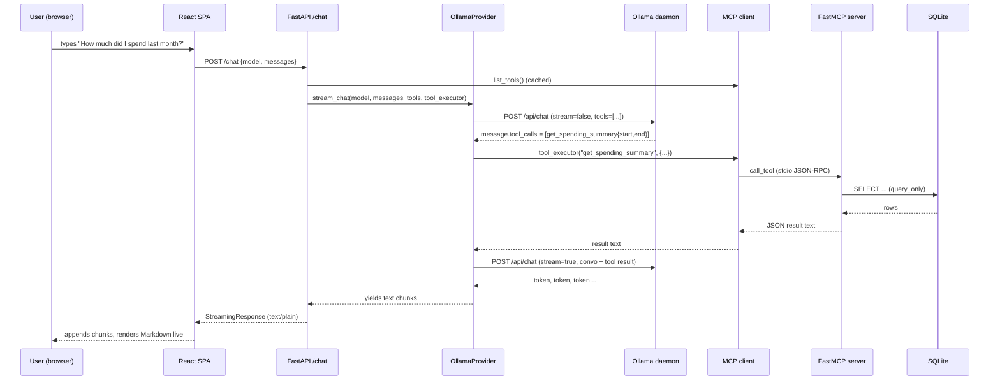
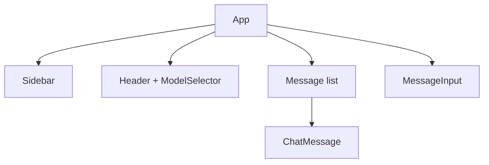
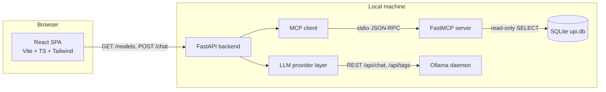
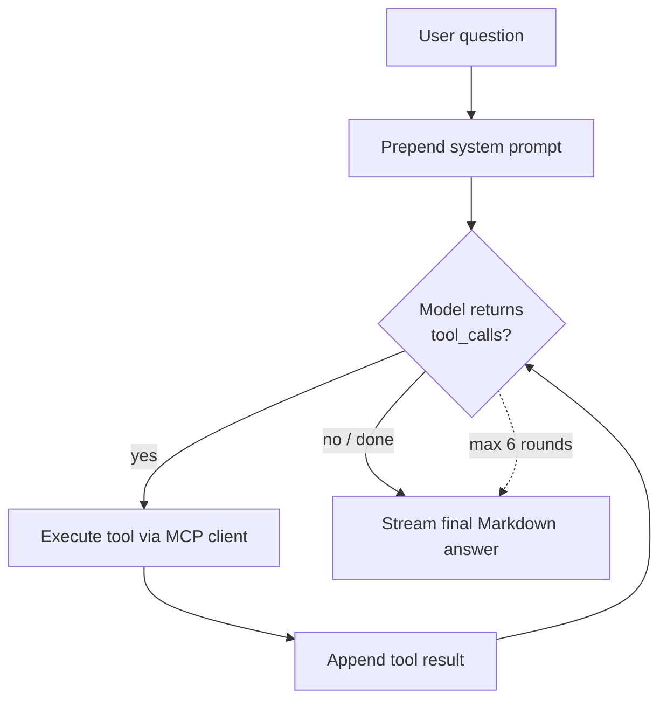
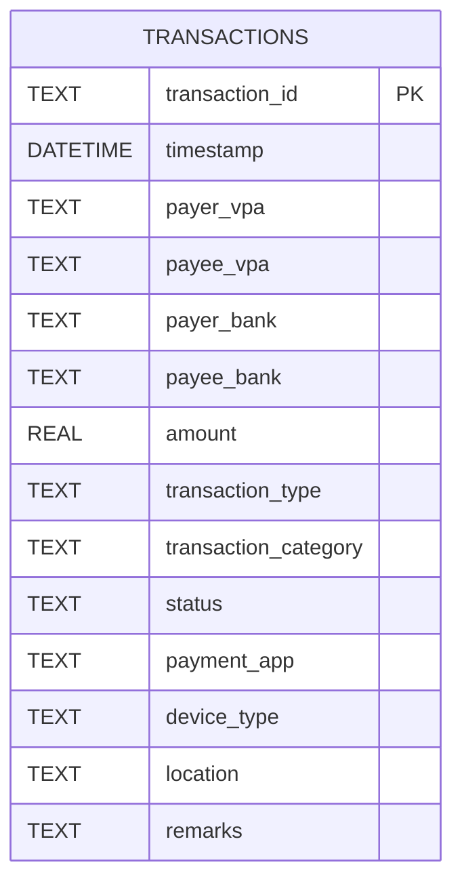
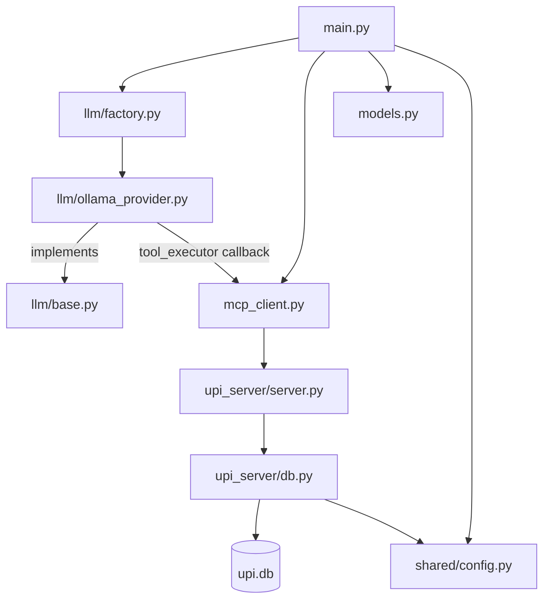
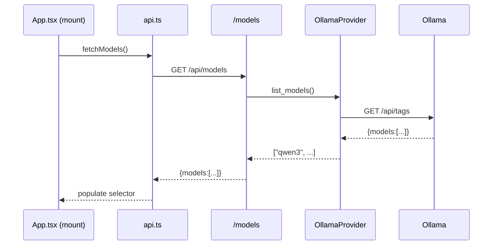

# Transaction Analytics — Senior Engineer Onboarding & Architecture Guide

> Audience: a senior engineer who has never seen this project. This document
> explains **what** every part does and **why** it was built that way. It is
> exhaustive by design. If you only read one file, read this one — then read
> the files in the order given in §20.

---

## 1. Executive Summary

### The problem
People accumulate large UPI (Unified Payments Interface) transaction histories
across many apps (GPay, PhonePe, Paytm…). That raw history is hard to reason
about: "How much did I spend on food last month?" is trivial to ask in English
but tedious to answer by hand. General-purpose chatbots can't answer it because
they don't have your data, and handing a raw database to an LLM to write SQL is
both a **safety risk** (it could emit destructive SQL) and a **correctness
risk** (hallucinated columns, wrong aggregations).

This project solves that: a **local-first, ChatGPT-style app** that answers
natural-language questions about your UPI history by having a **local LLM call a
fixed set of vetted, read-only analytics tools** rather than writing SQL.

### Primary goals
1. **Local-first / private.** Everything runs on the user's machine — the model
   (via Ollama), the API, the tools, and the SQLite database. No data leaves
   the device.
2. **Safe by construction.** The LLM never sees or writes SQL. It can only call
   named, typed analytics tools, all of which are read-only. This is enforced at
   the database layer, not just by convention.
3. **Model-agnostic.** The LLM provider is behind an interface so Ollama today
   can become OpenAI or Anthropic tomorrow with no changes to the API surface,
   the MCP layer, or the frontend.
4. **Extensible.** New analytics capabilities are added by writing one Python
   function; the frontend needs no changes.

### Intended users
- **Primary:** an individual analyzing their own UPI spending, running the whole
  stack locally.
- **Secondary (by design):** developers who want a clean reference for the
  pattern "LLM + MCP tools + local DB," and who will extend it (new tools, new
  providers, hosted deployment).

### Key workflows
1. **Ask a question.** User types "How much did I spend last month?" → the
   backend gives the model the question plus the tool catalog → the model calls
   `get_spending_summary` with a resolved date range → the tool queries SQLite →
   the model turns the numbers into prose → the answer streams back token by
   token.
2. **Switch models.** The frontend lists installed Ollama models (`GET /models`)
   and lets the user pick one per conversation.
3. **Manage conversations.** A sidebar keeps multiple chat threads, persisted in
   the browser's `localStorage`.

---

## 2. High-Level Architecture

### Mental model
Think of the system as **four layers with one hard security boundary**:

```
  Presentation  →  Orchestration  →  Capability  →  Data
  (React SPA)      (FastAPI +         (FastMCP        (SQLite,
                    LLM provider)      tools)          read-only)
                          │                │
                          └── LLM decides ─┘
                              which tool to call
```

- **Presentation (React):** renders chat, streams answers, lets the user pick a
  model and manage conversations. Knows nothing about SQL, MCP, or Ollama — it
  only speaks to two HTTP endpoints.
- **Orchestration (FastAPI + LLM provider layer + MCP client):** the brain. It
  owns the LLM tool-calling loop: send messages + tool catalog to the model,
  execute any tool calls, feed results back, stream the final answer.
- **Capability (FastMCP servers):** two servers (UPI + IMPS), each exposing ten
  business-level analytics tools.
  Each tool is a Python function that builds a parameterized SELECT. This is the
  **only** component that talks to the database.
- **Data (SQLite):** a single `transactions` table. Opened read-only.

The **hard boundary** sits in `upi_server/db.py`: connections use
`PRAGMA query_only=ON` and a regex guard rejects any non-SELECT statement. Even
if a tool (or a future bug, or a jailbroken model) tried to mutate data, the DB
layer refuses.

### Why MCP at all?
MCP (Model Context Protocol) is the contract between "the thing that decides
which tool to call" (the LLM orchestrator) and "the thing that can do it" (the
analytics server). Using MCP instead of plain Python function calls buys three
things: (a) the tool catalog (names, descriptions, JSON-Schema parameters) is
**discovered at runtime**, so adding a tool requires no backend edits; (b) the
tool server is a **separate process** with its own dependencies and its own
narrow surface area; (c) the same tool server could later be reused by any other
MCP-speaking client (Claude Desktop, another agent, etc.).

### Request flow, end to end


---

## 3. Technology Stack Analysis

For each technology: **what**, **why chosen**, **role**, **how used here**,
**alternatives**, **tradeoffs**.

### Python 3.10+
- **What:** the backend + MCP server language.
- **Why:** best-in-class ecosystem for both web APIs (FastAPI) and the MCP SDK,
  which is Python-first. SQLite support is in the standard library.
- **Role:** everything server-side.
- **How:** `backend/`, `upi_server/`, `database/`, `shared/`.
- **Alternatives:** Node/TypeScript (would unify language with the frontend),
  Go (faster, but weaker MCP/LLM tooling).
- **Tradeoffs:** two languages in one repo (Python + TS) is a small cognitive
  cost, paid back by using each ecosystem's strengths. The `3.10+` floor is
  required for modern typing (`X | None`) and `asyncio` ergonomics.

### FastAPI (`backend/main.py`)
- **What:** an async Python web framework built on Starlette + Pydantic.
- **Why:** native `async`/`await` (needed because the MCP client and Ollama
  streaming are async), first-class streaming responses, automatic request
  validation from Pydantic models, and auto-generated OpenAPI docs at `/docs`.
- **Role:** HTTP surface (`/models`, `/chat`, `/health`), CORS, app lifespan.
- **How:** `app = FastAPI(..., lifespan=lifespan)`; endpoints are async
  functions; `/chat` returns a `StreamingResponse`.
- **Alternatives:** Flask (no native async, awkward streaming), Django (too
  heavy for a two-endpoint API), Node/Express.
- **Tradeoffs:** FastAPI is the near-obvious choice for an async, typed Python
  API. Minimal downside here.

### Pydantic v2 (`backend/models.py`)
- **What:** data-validation / serialization library; FastAPI uses it to parse
  and validate request bodies.
- **Why:** turns untyped JSON into validated typed objects and back, with clear
  errors, at the edge of the system.
- **Role:** defines `ChatMessage`, `ChatRequest`, `ModelsResponse`, `ToolInfo`.
- **How:** `class ChatRequest(BaseModel)` with typed fields; FastAPI injects a
  validated `ChatRequest` into the `/chat` handler.
- **Alternatives:** dataclasses + manual validation, `marshmallow`, `attrs`.
- **Tradeoffs:** Pydantic v2 is fast (Rust core) and idiomatic with FastAPI.

### Uvicorn
- **What:** an ASGI server.
- **Why:** the standard way to run FastAPI; supports HTTP/1.1 streaming and
  `--reload` for development.
- **Role:** process that hosts the ASGI app.
- **How:** `uvicorn backend.main:app --reload`.
- **Alternatives:** Hypercorn, Daphne, Gunicorn+uvicorn workers (for prod).
- **Tradeoffs:** single-process `--reload` is dev-only; production would front
  it with Gunicorn workers or run multiple Uvicorn workers.

### httpx (`backend/llm/ollama_provider.py`)
- **What:** an async-capable HTTP client.
- **Why:** the provider must call Ollama's REST API (`/api/tags`, `/api/chat`)
  asynchronously and **stream** the chat response line by line.
- **Role:** transport between backend and the Ollama daemon.
- **How:** `httpx.AsyncClient`, `client.stream("POST", ...)`, `aiter_lines()`.
- **Alternatives:** `aiohttp`, `requests` (sync — would block the event loop).
- **Tradeoffs:** httpx has the cleanest async streaming API in Python today.

### MCP Python SDK / FastMCP (`mcp[cli]`)
- **What:** the official Model Context Protocol SDK. `FastMCP` is its
  decorator-based server framework; the SDK also ships a client
  (`ClientSession`, `stdio_client`).
- **Why:** MCP is the standardized way to expose "tools" to LLM agents. FastMCP
  turns a plain function + docstring + type hints into a fully described tool
  (JSON-Schema parameters auto-generated from the signature).
- **Role:** server side (`upi_server/server.py` uses `FastMCP` + `@mcp.tool()`),
  client side (`backend/mcp_client.py` uses `ClientSession` over stdio).
- **How:** server runs `mcp.run()` (stdio transport); backend spawns it as a
  subprocess and speaks JSON-RPC over stdin/stdout.
- **Alternatives:** hand-rolled function registry + JSON schemas; LangChain
  tools; direct Python calls (would lose process isolation and runtime
  discovery).
- **Tradeoffs:** MCP adds a subprocess and a protocol, but yields isolation,
  runtime tool discovery, and reusability by other MCP clients.

### Ollama
- **What:** a local LLM runtime with a REST API (default `http://localhost:11434`).
- **Why:** enables the local-first goal — models run on the user's machine, with
  no API keys and no data egress. Its `/api/chat` supports **tool calling**,
  which the whole design depends on.
- **Role:** the actual inference engine in v1.
- **How:** `GET /api/tags` for discovery; `POST /api/chat` with `tools` for the
  tool-calling loop and final streaming.
- **Alternatives:** llama.cpp server, LM Studio, vLLM; or hosted OpenAI/
  Anthropic (which the provider layer is designed to add later).
- **Tradeoffs:** local models are private and free but weaker at tool-calling
  than frontier hosted models; requires a tool-capable model (qwen3, llama3.1,
  mistral-nemo).

### SQLite (`database/`)
- **What:** an embedded, file-based SQL database (standard library `sqlite3`).
- **Why:** zero-configuration, single-file, perfect for a local-first app. No
  server to run.
- **Role:** the single source of truth for transactions.
- **How:** `database/upi.db`, schema in `schema.sql`, seeded by `seed.py`,
  queried by `upi_server/db.py`.
- **Alternatives:** DuckDB (great for analytics — a strong future swap),
  Postgres (needs a server), Parquet + a query engine.
- **Tradeoffs:** SQLite is single-writer and not built for heavy concurrent
  analytics, but the workload here is small, local, and read-only.

### React 18 + Vite + TypeScript (`frontend/`)
- **What:** React is the UI library; Vite the build tool/dev server; TypeScript
  the typed language.
- **Why:** React is the default for component UIs; Vite gives instant HMR and a
  simple dev proxy; TS catches errors and documents shapes (`types.ts`).
- **Role:** the entire chat UI.
- **How:** `npm run dev` (Vite), components under `src/components`, types in
  `src/types.ts`.
- **Alternatives:** Next.js (SSR — unnecessary for a local SPA), Vue/Svelte,
  Create React App (deprecated, slower).
- **Tradeoffs:** a plain Vite SPA is the lightest choice; no SSR needed because
  there's no SEO/first-paint concern for a local tool.

### TailwindCSS (+ PostCSS + Autoprefixer)
- **What:** a utility-first CSS framework compiled via PostCSS.
- **Why:** fast iteration on a bespoke dark ChatGPT-like UI without writing
  bespoke CSS files; only a little global CSS is needed (`index.css`).
- **Role:** all component styling.
- **How:** utility classes in JSX; theme colors extended in
  `tailwind.config.js`; global Markdown/scroll styles in `index.css`.
- **Alternatives:** CSS Modules, styled-components, MUI/Chakra component kits.
- **Tradeoffs:** utility classes make JSX verbose but keep styling local and
  consistent; a component kit would add weight and fight the custom look.

### react-markdown + remark-gfm (`components/ChatMessage.tsx`)
- **What:** render Markdown (incl. GitHub-flavored tables, strikethrough) to
  React elements.
- **Why:** the LLM answers in Markdown; tables and lists must render cleanly.
- **Role:** assistant message rendering.
- **How:** `<ReactMarkdown remarkPlugins={[remarkGfm]}>`.
- **Alternatives:** `marked` + `dangerouslySetInnerHTML` (XSS risk), MDX.
- **Tradeoffs:** react-markdown avoids raw HTML injection and is safe by default.

---

## 4. Repository Structure

```
mcpServer/
├── README.md                 Quick-start + tool reference
├── ONBOARDING.md             (this file)
├── requirements.txt          Aggregate Python deps (backend + MCP)
├── .env.example              All env vars with defaults, documented
├── .gitignore                Ignores venv, node_modules, *.db, .env
│
├── database/
│   ├── schema.sql            The transactions table + indexes (single source of truth)
│   └── seed.py               Deterministic synthetic-data generator → upi.db
│
├── shared/
│   ├── __init__.py           Marks package
│   └── config.py             Env-resolved config shared by backend + MCP server
│
├── upi_server/
│   ├── __init__.py
│   ├── db.py                 Read-only SQLite access layer (the security boundary)
│   ├── server.py             FastMCP server: 8 @mcp.tool() analytics functions
│   └── requirements.txt      MCP-only deps (mcp[cli])
│
├── backend/
│   ├── __init__.py
│   ├── main.py               FastAPI app: /models, /chat, /health, lifespan
│   ├── models.py             Pydantic request/response models
│   ├── mcp_client.py         Async MCP client (spawns server over stdio)
│   ├── requirements.txt      Backend deps
│   └── llm/
│       ├── __init__.py
│       ├── base.py           LLMProvider abstract interface
│       ├── ollama_provider.py    Working Ollama implementation
│       ├── openai_provider.py    Stub (future)
│       ├── anthropic_provider.py Stub (future)
│       └── factory.py        get_provider(): selects provider from config
│
├── frontend/
│   ├── package.json          Frontend deps + scripts
│   ├── vite.config.ts        Dev server + /api → :8000 proxy
│   ├── tsconfig.json         TS config (strict)
│   ├── tsconfig.node.json    TS config for Vite config file
│   ├── tailwind.config.js    Theme colors (sidebar/surface/bubble)
│   ├── postcss.config.js     Tailwind + Autoprefixer
│   ├── index.html            SPA entry HTML (dark theme, #root)
│   └── src/
│       ├── main.tsx          React bootstrap (mounts <App/>)
│       ├── App.tsx           Root component: state, model load, streaming loop
│       ├── index.css         Global + Markdown + streaming-cursor styles
│       ├── types.ts          Message / Conversation types
│       ├── api.ts            fetchModels() + streamChat()
│       ├── vite-env.d.ts     Vite type shim
│       └── components/
│           ├── Sidebar.tsx        Conversation list + new/delete
│           ├── ModelSelector.tsx  Model dropdown
│           ├── ChatMessage.tsx    One message bubble (Markdown for assistant)
│           └── MessageInput.tsx   Auto-growing textarea + send/stop
│
└── scripts/
    ├── setup.sh / setup.bat          One-time venv + install + seed
    ├── run_backend.sh / .bat         Seed-if-needed + uvicorn
    └── run_frontend.sh / .bat        npm install + vite dev
```

### Entry points
- **Backend:** `backend/main.py` → `app` (run by Uvicorn).
- **MCP server:** `upi_server/server.py` `__main__` → `mcp.run()` (spawned by the
  backend, not run by hand in normal use).
- **Frontend:** `frontend/index.html` → `src/main.tsx` → `<App/>`.
- **Data bootstrap:** `database/seed.py` `__main__`.

### Why this layout
The top-level folders map **one-to-one to the four architectural layers** plus a
`shared/` for the config both Python processes need and `scripts/` for
ergonomics. Module boundaries are deliberately narrow: only `upi_server/db.py`
imports `sqlite3`; only `ollama_provider.py` imports `httpx`; only
`mcp_client.py` imports the MCP client SDK. That makes each concern swappable in
isolation.

---

## 5. Detailed Component Analysis

### `shared/config.py`
- **Purpose:** one place that resolves all configuration from environment
  variables with sane defaults, imported by both the backend and the MCP server.
- **Inputs:** environment variables (`UPI_DB_PATH`, `LLM_PROVIDER`,
  `OLLAMA_HOST`, `DEFAULT_MODEL`, `MCP_SERVER_CMD/SCRIPT`, `BACKEND_HOST/PORT`,
  `CORS_ORIGINS`).
- **Outputs:** module-level constants.
- **Key detail:** `ROOT` is derived as the parent of `shared/`, so
  `DB_PATH` and `MCP_SERVER_SCRIPT` default to repo-relative paths regardless of
  the current working directory. `CORS_ORIGINS` is split on commas into a list.
- **Interactions:** imported by `upi_server/db.py`, `backend/mcp_client.py`,
  `backend/main.py`, `backend/llm/*`.

### `database/schema.sql`
- **Purpose:** the canonical definition of the `transactions` table and its
  indexes. Both `seed.py` (via `executescript`) and human readers use it.
- **Detail:** `CREATE TABLE IF NOT EXISTS` + five indexes on the columns the
  analytics tools filter/group by (`timestamp`, `transaction_category`,
  `status`, `location`, `payee_vpa`). See §7.

### `database/seed.py`
- **Purpose:** generate realistic synthetic UPI data so the app is usable out of
  the box.
- **Inputs:** CLI args `--db`, `--rows` (default 2000), `--seed` (default 42).
- **Outputs:** writes/overwrites `upi.db`, prints the row count.
- **Internal logic:**
  - `MERCHANTS` maps each category → list of `(merchant, vpa, (lo, hi))` amount
    ranges, so amounts are plausible per merchant.
  - `STATUSES` is a weighted list (≈88% SUCCESS, 9% FAILED, 3% PENDING) —
    sampling from it yields a realistic success rate.
  - `build_row()` picks a category+merchant, an amount via `random.uniform`
    within the merchant's range, and a timestamp via `random.triangular(0, 365,
    20)` days back — **biased toward the recent past** so "last month" queries
    have plenty of data.
  - `seed()` seeds the RNG (default 42 → **deterministic**), drops and recreates
    the table, then bulk-inserts with `executemany` in one transaction.
- **Key decisions:** `INSERT OR IGNORE` guards against the astronomically
  unlikely UUID collision; determinism makes demos and tests reproducible.
- **Dependencies:** stdlib only (`sqlite3`, `random`, `uuid`, `datetime`).

### `upi_server/db.py` — the security boundary
- **Purpose:** the **only** module that opens the database, and the enforcement
  point that keeps the entire system read-only.
- **Public API:** `query(sql, params) -> list[dict]`,
  `query_one(sql, params) -> dict | None`.
- **Internal logic:**
  - `_connect()`: raises a helpful `FileNotFoundError` if `upi.db` is missing
    (pointing the user at `seed.py`), sets `row_factory = sqlite3.Row` (so rows
    become dicts), and issues `PRAGMA query_only = ON` — SQLite itself will now
    reject writes on this connection.
  - `_assert_read_only(sql)`: **defense in depth** on top of the pragma. It (a)
    requires the statement to start with `SELECT` or `WITH` via `_ALLOWED_PREFIX`,
    and (b) scans for forbidden keywords (`insert|update|delete|drop|alter|
    create|replace|attach|detach|pragma|vacuum|reindex`) via `_FORBIDDEN` —
    **after** stripping single-quoted string literals, so a data value like a
    remark containing the word "update" cannot trip the guard.
  - `query()` runs the validated SQL with bound `params` and returns dict rows.
- **Why two layers (pragma + regex):** the pragma is the real enforcement; the
  regex gives clearer errors and blocks obviously-wrong SQL before it reaches
  SQLite. Together they mean "read-only" is guaranteed regardless of tool bugs.
- **Note on `pragma_table_info`:** the schema tool uses SQLite's
  `pragma_table_info(...)` **table-valued function inside a SELECT**. The
  `_FORBIDDEN` word-boundary regex (`\bpragma\b`) does not match
  `pragma_table_info` because `_` is a word character, so this legitimate
  read-only introspection is allowed while `PRAGMA` statements are blocked.

### `upi_server/server.py` — the tool catalog
- **Purpose:** expose business-level analytics as MCP tools. Each `@mcp.tool()`
  function's **name, docstring, and typed signature** become the tool's name,
  description, and JSON-Schema parameters that the LLM sees.
- **Shared helper:** `_date_clause(start_date, end_date)` returns
  `(clauses, params)` for an **inclusive** date range. The end bound uses
  `timestamp < datetime(?, '+1 day')` so an end date of `2026-06-30` includes
  all of June 30th regardless of time-of-day — a classic off-by-one guard.
- **The ten tools** (all read-only; see §8 for parameters/returns):
  `get_schema`, `get_transactions`, `get_spending_summary`,
  `get_category_breakdown`, `get_breakdown`, `get_top_merchants`,
  `get_transaction_stats`, `search_transactions`, `get_monthly_spending_trend`,
  `compare_periods`. The IMPS server mirrors this set for transfers.
- **Generalized tools (design principle):** rather than a tool per question,
  ranking and breakdown tools are **parameterized** so one tool serves many
  questions. `get_top_merchants(..., limit, sort_by, order)` gives "the single
  biggest" (`limit=1`), "top 10" (`limit=10`), "most frequent"
  (`sort_by='count'`) or "smallest" (`order='asc'`). `get_breakdown(dimension,
  ...)` groups by any whitelisted dimension, and with `limit=1` becomes "top X
  by that dimension". `compare_periods` diffs two ranges.
- **Important implementation details:**
  - "Spend" is consistently defined as `status='SUCCESS' AND
    transaction_type='DEBIT'` in the summary/breakdown/merchants/trend tools, so
    numbers are comparable across tools.
  - `limit` parameters are clamped (`max(1, min(limit, 1000))` or `100`) to
    prevent a model from requesting an unbounded result set.
  - **`sort_by`, `order` and `dimension` become SQL keywords/identifiers, so they
    are NEVER interpolated from raw input** — they are resolved through whitelist
    maps (`_SORT_EXPR`, `_DIMENSIONS`); an unknown value raises. All data values
    remain bound parameters.
  - Every SQL string is otherwise parameterized; user/LLM-supplied values are
    always bound, never interpolated.
- **Entrypoint:** `mcp.run()` starts the stdio server loop.

### `backend/models.py`
- **Purpose:** typed request/response contracts.
- **Members:** `Role` (literal union), `ChatMessage` (role/content + optional
  `name`/`tool_call_id` used when replaying tool turns), `ChatRequest`
  (`model`, `messages`, `temperature`), `ModelsResponse` (`models: list[str]`),
  `ToolInfo`.
- **Detail:** `content` defaults to `""` so an assistant tool-call turn with no
  text validates. Handlers serialize with `model_dump(exclude_none=True)` to keep
  optional fields out of the wire payload.

### `backend/mcp_client.py`
- **Purpose:** manage a **single long-lived** MCP session for the process and
  expose `list_tools()` + `call_tool()`.
- **Internal logic:**
  - `connect()`: builds `StdioServerParameters` (command `python`, arg = the
    server script, inheriting the current env so `UPI_DB_PATH` etc. propagate),
    enters `stdio_client(...)` and `ClientSession(...)` via an `AsyncExitStack`,
    then `initialize()`. Idempotent (returns early if already connected).
  - `list_tools()`: converts MCP tool objects into provider-neutral dicts
    `{name, description, parameters(JSON schema)}` and **caches** them (the
    catalog is static for the process lifetime).
  - `call_tool(name, args)`: invokes the tool and concatenates the text blocks of
    the result into a single string for the LLM. Note: tools that return a
    **list** come back as one JSON object per row (multiple content blocks), so
    the joined string holds several stacked JSON objects rather than one array —
    the LLM reads this as text fine, but Python callers must parse iteratively.
  - `close()`: unwinds the exit stack (terminates the subprocess).
- **Design:** a module-level singleton `mcp_client` is created once and reused
  across requests, so the subprocess and session are shared, not per-request.

### `backend/llm/base.py`
- **Purpose:** the model-agnostic contract. `LLMProvider` is an ABC with
  `list_models()` and `stream_chat(...)`. `ToolExecutor` is a type alias for the
  async callback `(name, args) -> result_text` that a provider calls to run a
  tool. This is the seam that makes the whole system provider-independent.

### `backend/llm/ollama_provider.py`
- **Purpose:** the working provider. Implements discovery and the full
  tool-calling loop.
- **`list_models()`:** `GET {host}/api/tags`, returns model names, stripping a
  trailing `:latest` tag for cleaner display.
- **`stream_chat(...)`:** the heart of the system.
  1. Convert the neutral tool dicts to Ollama's `{"type":"function", ...}` shape
     via `_to_ollama_tools`.
  2. **Tool-resolution rounds (non-streamed), up to `MAX_TOOL_ROUNDS = 6`:** call
     `/api/chat` with `stream=false`. If the model returned `tool_calls`, append
     the assistant message, execute each tool via `tool_executor` (parsing string
     arguments as JSON if needed, and catching exceptions so tool errors are fed
     back to the model as text), append each result as a `{"role":"tool", ...}`
     message, and loop. If no tool calls, break (emitting any content directly).
  3. **Final streamed answer:** call `/api/chat` with `stream=true`, iterate
     `aiter_lines()`, parse each JSON line, and `yield` the incremental
     `message.content` until `done`.
- **Why non-streamed tool rounds then a streamed answer:** tool_calls arrive as a
  structured field that is awkward to assemble from a token stream; resolving
  tools without streaming is simpler and robust, and only the final human-facing
  answer needs to stream.

### `backend/llm/openai_provider.py`, `anthropic_provider.py`
- **Purpose:** future providers. Each implements `LLMProvider` but raises
  `NotImplementedError`. They include the `yield` after the raise so Python still
  treats `stream_chat` as an async generator (matching the interface). The
  Anthropic stub notes its different `tool_use`/`tool_result` block model.

### `backend/llm/factory.py`
- **Purpose:** `get_provider(name)` maps a provider string (from `LLM_PROVIDER`
  or an override) to a concrete provider, importing the OpenAI/Anthropic modules
  lazily so their (future) SDKs aren't required unless selected. Raises on an
  unknown name.

### `backend/main.py`
- **Purpose:** the HTTP surface + app lifecycle.
- **`_system_prompt()`:** injects **today's date** and the operating rules:
  data is only reachable via tools; resolve relative dates to `YYYY-MM-DD`; call
  `get_schema` if unsure; amounts are ₹; answer in Markdown; never invent values.
- **`lifespan`:** connects the MCP client on startup, closes it on shutdown — so
  the subprocess is spawned once per server, not per request.
- **`/health`:** liveness probe.
- **`/models`:** delegates to the provider; on failure returns `503` with a
  message ("Could not reach ollama…").
- **`/chat`:** loads the cached tool catalog, prepends the system prompt if the
  client didn't send one, and returns a `StreamingResponse` whose generator
  yields provider chunks; exceptions are streamed inline as `[error] …` rather
  than turning into a 500 mid-stream.

### Frontend components
- **`main.tsx`:** mounts `<App/>` into `#root` under `React.StrictMode`.
- **`App.tsx`:** the single stateful root — see §9.
- **`api.ts`:** `fetchModels()` (GET `/api/models`) and `streamChat()` which
  POSTs to `/api/chat` and reads the `ReadableStream` via a `TextDecoder`,
  invoking `onChunk` for each decoded piece; supports an `AbortSignal`.
- **`Sidebar.tsx`:** conversation list, new/delete, mobile drawer with backdrop.
- **`ModelSelector.tsx`:** controlled `<select>` populated from `/models`.
- **`ChatMessage.tsx`:** renders a user bubble as plain text and an assistant
  bubble via `react-markdown` + `remark-gfm`, adding a blinking cursor class
  while streaming.
- **`MessageInput.tsx`:** auto-growing textarea; Enter sends, Shift+Enter
  newlines; toggles a send/stop button based on `busy`.

---

## 6. Data Flow Analysis

**Source → output**, tracing one question:

1. **Origin (browser):** the user's text enters React state in `MessageInput`
   and is passed up to `App.send(text)`.
2. **Optimistic state change:** `App` appends a `user` message and an empty
   `assistant` placeholder to the active conversation, and updates the title if
   this is the first message.
3. **Request assembly:** `App` builds the message history (excluding the empty
   placeholder) and calls `streamChat(model, history, onChunk, signal)`.
4. **Transport:** `api.ts` POSTs `{model, messages}` JSON to `/api/chat` (Vite
   proxies `/api` → `:8000`).
5. **Backend transform:** FastAPI validates into a `ChatRequest`, serializes the
   messages, prepends the system prompt, and calls the provider.
6. **Decision:** Ollama returns `tool_calls`. The provider executes them via the
   MCP client.
7. **Capability transform:** the MCP tool converts typed parameters into a
   parameterized SELECT; `db.py` runs it read-only and returns dict rows; MCP
   serializes them to JSON text.
8. **Synthesis:** the JSON result is appended as a `tool` message; the model now
   streams a natural-language answer.
9. **Streaming back:** provider `yield`s → FastAPI `StreamingResponse` → fetch
   `ReadableStream` → `onChunk` → `App` appends each chunk to the assistant
   placeholder's `content`.
10. **Render + persist:** React re-renders the growing Markdown; a `useEffect`
    on `conversations` writes them to `localStorage`.

**State locations:** transient UI state in React; durable transactions in
SQLite; conversation history in the browser's `localStorage` (never sent to any
server beyond the per-request `messages` array). The LLM's working memory is the
`convo` list assembled per request — there is no server-side session store.

---

## 7. Database Analysis

### Schema (`database/schema.sql`)
Single table, `transactions`:

| Column | Type | Notes |
|---|---|---|
| `transaction_id` | TEXT PK | `TXN` + 16 hex chars (from `uuid4`) |
| `timestamp` | DATETIME | `YYYY-MM-DD HH:MM:SS`; filtered/grouped constantly |
| `payer_vpa` | TEXT | the user's VPA (e.g. `you@okhdfcbank`) |
| `payee_vpa` | TEXT | merchant/person VPA; used as "merchant" key |
| `payer_bank` / `payee_bank` | TEXT | bank names |
| `amount` | REAL | ₹; the core measure |
| `transaction_type` | TEXT | `DEBIT` / `CREDIT` |
| `transaction_category` | TEXT | Shopping, Food, Bills… (grouping dimension) |
| `status` | TEXT | `SUCCESS` / `FAILED` / `PENDING` |
| `payment_app` | TEXT | GPay, PhonePe… |
| `device_type` | TEXT | Android / iOS / Web |
| `location` | TEXT | city (for "which city…" queries) |
| `remarks` | TEXT | free text; also searched by `search_transactions` |

### Relationships
This is a deliberately **denormalized single-table** design. VPAs, banks, and
categories are stored inline rather than in lookup tables. For a local,
read-only analytics workload this is the right call: it removes all JOINs,
keeps every tool a single-table aggregate, and matches how UPI data is typically
exported (one flat row per transaction).

### Indexes & constraints
- **PK:** `transaction_id` (unique identity, prevents duplicate rows).
- **Indexes:** `timestamp`, `transaction_category`, `status`, `location`,
  `payee_vpa` — precisely the columns the tools filter and group by, so
  aggregates stay fast as row counts grow.
- **NOT NULL** on the columns every tool relies on (`timestamp`, `amount`,
  VPAs).

### How data is queried / updated
- **Queried:** only through the eight MCP tools → `db.query()` → parameterized
  SELECTs on a `query_only` connection.
- **Updated:** only by `seed.py`, which is the sole writer and runs a full
  drop-and-recreate. In normal operation the DB is **read-only** — there is no
  write path from the app.

---

## 8. API Analysis

Two functional endpoints plus health.

### `GET /health`
Returns `{"status":"ok"}`. No auth, no validation. Liveness probe.

### `GET /models`
- **Response:** `{"models": ["qwen3", "llama3.1", ...]}` (`ModelsResponse`).
- **Logic:** `get_provider().list_models()` → Ollama `/api/tags`.
- **Errors:** if Ollama is unreachable, returns **503** with detail
  "Could not reach ollama: …" so the frontend can show a clear banner.

### `POST /chat`
- **Request (`ChatRequest`):** `{ "model": str, "messages": ChatMessage[],
  "temperature"?: float }`. FastAPI/Pydantic validate the body; a malformed body
  yields an automatic **422**.
- **Response:** `StreamingResponse` of `text/plain` chunks (the assistant's
  answer, streamed). Headers disable caching and proxy buffering
  (`X-Accel-Buffering: no`).
- **Business logic:** fetch tool catalog → prepend system prompt if absent →
  run the provider's tool-calling loop → stream the final answer. Errors during
  streaming are emitted inline as `[error] …` text (a deliberate choice: once the
  200 stream has started you can't switch to a 500, so surfacing the error in the
  body is the honest option).

### Auth / authorization
There is **none**, by design: the app is local-first and single-user, bound to
`127.0.0.1`. CORS is restricted to the Vite dev origins. See §13 for what would
change before any networked deployment.

---

## 9. Frontend Analysis

### Component hierarchy


### State management
All state lives in **`App.tsx`** via `useState`/`useMemo`/`useRef` — no Redux/
context needed for this size.
- `conversations` (array; the source of truth, persisted to `localStorage` by a
  `useEffect`), `activeId` (which thread is open), derived `active` via `useMemo`.
- `models`, `model`, `loadingModels`, `modelError` — model discovery state.
- `busy` (a request is streaming), `sidebarOpen` (mobile drawer).
- `abortRef` (an `AbortController` so "Stop" cancels the fetch), `scrollRef`
  (autoscroll target).

### Routing
None — single view. Conversation "navigation" is just changing `activeId`.

### Data fetching patterns
- **Model discovery:** one `fetchModels()` on mount (`useEffect`), with
  loading/error states and a fallback to select the first model.
- **Chat:** `streamChat()` reads a `ReadableStream`; each decoded chunk is
  appended to the last (assistant) message via an immutable state update, so
  React re-renders progressively — this is what produces the live "typing"
  effect. Autoscroll is a `useEffect` keyed on `active?.messages`.

### Rendering lifecycle for a message
User submits → two messages appended (user + empty assistant) → fetch starts →
each chunk mutates the assistant message's `content` immutably → `ChatMessage`
re-renders Markdown with a blinking cursor while `busy` → on completion the
cursor stops and `localStorage` holds the final thread.

---

## 10. Backend Analysis

- **Service architecture:** a single FastAPI process that also **supervises** a
  child MCP process over stdio. No microservices; the "services" are logical
  layers (HTTP, provider, MCP client).
- **"Controllers":** the three endpoint functions in `main.py`.
- **Business-logic layers:** the provider layer (`llm/`) owns the agentic loop;
  the MCP client (`mcp_client.py`) owns tool transport; the MCP server owns the
  analytics logic. `main.py` is thin glue.
- **Middleware:** `CORSMiddleware` only.
- **Background jobs / events:** none, except the FastAPI **lifespan** hook that
  opens/closes the MCP session. There are no queues, schedulers, or webhooks.

---

## 11. AI / LLM Analysis

- **Workflow:** a bounded **tool-calling agent loop** (not RAG, no vector DB).
  The model is given the question + tool catalog and decides which tool(s) to
  call; results are fed back; it writes the final answer. No embeddings, no
  retrieval, no fine-tuning.
- **Prompt construction:** `_system_prompt()` in `main.py` builds the system
  message with today's date and hard rules (tools are the only data source;
  resolve relative dates; ₹; Markdown; don't invent numbers). User/assistant/
  tool messages accumulate in the per-request `convo` list.
- **Context management:** the full conversation is sent each request (stateless
  server). Tool outputs enter context as `role:"tool"` messages. There is no
  summarization/trimming yet — a natural future improvement for long threads.
- **Memory handling:** durable "memory" is just the browser's conversation
  history; the model has no cross-request memory beyond the messages resent.
- **Agent architecture:** single agent, single loop, `MAX_TOOL_ROUNDS = 6` to
  bound cost and prevent infinite tool cycles. Tool errors are returned to the
  model as text so it can recover or explain.
- **Model selection rationale:** local, tool-capable Ollama models
  (qwen3/llama3.1/mistral-nemo). The provider layer (`LLMProvider`) is the seam
  for adding hosted models later without touching the loop's callers.
- **RAG / vector DB:** intentionally **absent** — the data is small, structured,
  and best served by exact SQL aggregates, not semantic retrieval.

---

## 12. Infrastructure & Deployment

- **Deployment architecture (v1):** entirely local. Uvicorn on `127.0.0.1:8000`
  supervising the MCP subprocess; Vite dev server on `:5173` proxying `/api`;
  Ollama on `:11434`; SQLite file on disk.
- **CI/CD:** none yet (single-developer local project). A natural first pipeline
  would lint (ruff/mypy, eslint/tsc) and run tool tests.
- **Docker:** none yet. A future compose would run three services (backend+MCP,
  frontend, Ollama) — note Ollama needs the model volume and ideally GPU.
- **Cloud services:** none — that's the point (local-first, private).
- **Environment variables:** documented in `.env.example` and resolved in
  `shared/config.py`: `UPI_DB_PATH`, `LLM_PROVIDER`, `OLLAMA_HOST`,
  `DEFAULT_MODEL`, `MCP_SERVER_CMD/SCRIPT`, `BACKEND_HOST/PORT`, `CORS_ORIGINS`,
  and future `OPENAI_API_KEY`/`ANTHROPIC_API_KEY`.
- **Scaling considerations:** SQLite is single-writer (irrelevant here since
  reads only). For multi-user hosting you'd run Uvicorn workers, externalize the
  DB (Postgres/DuckDB), and reconsider the per-request MCP subprocess model
  (pooling or an HTTP-transport MCP server).

---

## 13. Security Analysis

- **Read-only guarantee (the headline control):** `upi_server/db.py` opens every
  connection with `PRAGMA query_only=ON` and rejects any non-SELECT statement via
  `_assert_read_only`. The LLM cannot reach SQL directly at all — it only calls
  typed tools. This neutralizes prompt-injection-to-SQL and destructive-write
  risks.
- **Injection:** every query is parameterized; no LLM/user value is string-
  interpolated into SQL. `limit` values are clamped.
- **AuthN/AuthZ:** none in v1 — acceptable because the server binds to localhost
  and is single-user. Before any network exposure you'd add authentication,
  per-user data isolation, and rate limiting.
- **Data protection:** data never leaves the machine; there are no third-party
  API calls in the Ollama path. Conversations live only in `localStorage`.
- **Secrets management:** none needed for Ollama (no keys). Future hosted
  providers read keys from env (`OPENAI_API_KEY`/`ANTHROPIC_API_KEY`); `.env` is
  gitignored.
- **Potential vulnerabilities / hardening TODOs:** CORS is permissive on methods/
  headers (fine for localhost, tighten for prod); no request size/turn limits on
  `/chat` beyond `MAX_TOOL_ROUNDS`; Markdown rendering is safe (react-markdown
  doesn't inject raw HTML) but any future raw-HTML rendering would need
  sanitization.

---

## 14. Dependency Analysis

### Python (`requirements.txt` / `backend/requirements.txt` / `upi_server/requirements.txt`)
- **fastapi** — the async web framework; provides routing, validation,
  streaming, CORS.
- **uvicorn[standard]** — ASGI server that runs FastAPI; `[standard]` pulls in
  `uvloop`/`httptools`/websockets for performance.
- **pydantic** (v2) — request/response validation and serialization.
- **httpx** — async HTTP client used to call Ollama, including response
  streaming.
- **mcp[cli]** — the MCP SDK: `FastMCP` server, `ClientSession`, stdio transport;
  `[cli]` adds the `mcp` dev CLI. Present in both the backend (client role) and
  MCP server (server role) requirement files.

### Frontend (`frontend/package.json`)
Dependencies:
- **react**, **react-dom** — UI library + DOM renderer.
- **react-markdown** — render the LLM's Markdown answers safely.
- **remark-gfm** — GitHub-flavored Markdown (tables, strikethrough) for
  react-markdown.

Dev dependencies:
- **vite** — dev server + bundler.
- **@vitejs/plugin-react** — React fast-refresh/JSX for Vite.
- **typescript** — typing + build-time checks.
- **@types/react**, **@types/react-dom** — React type definitions.
- **tailwindcss**, **postcss**, **autoprefixer** — utility CSS pipeline.

---

## 15. Design Patterns & Engineering Decisions

- **Strategy / provider pattern** (`LLMProvider` + `factory.get_provider`):
  swap LLM backends without touching callers. The single most important
  extensibility decision.
- **Adapter** (`_to_ollama_tools`): translate neutral tool schemas into a
  provider's wire format at the edge.
- **Facade** (`mcp_client.MCPClient`): hides MCP/stdio/JSON-RPC behind
  `list_tools()`/`call_tool()`.
- **Guard / gatekeeper** (`_assert_read_only` + `PRAGMA query_only`): a single
  chokepoint enforces the read-only invariant (defense in depth).
- **Singleton** (`mcp_client`) and **cache** (`_tools_cache`): reuse the
  subprocess/session and the static catalog.
- **Config module** (`shared/config.py`): one env-resolution point for two
  processes.
- **Tool-as-documentation:** each tool's docstring is its LLM-facing description,
  so writing a good docstring is a functional requirement, not a nicety.
- **Code-quality observations:** narrow imports per module, consistent "spend =
  SUCCESS+DEBIT" definition, clamped limits, parameterized SQL, inclusive-date
  helper reused everywhere.
- **Technical debt / refactor opportunities:** OpenAI/Anthropic providers are
  stubs; no automated tests yet; no context-window trimming for long chats; MCP
  subprocess is per-server (fine locally, would need pooling for scale);
  `payee_vpa` doubles as the "merchant" identity (a display-name mapping would be
  nicer). None of these block v1.

---

## 16. Execution Walkthrough (startup)

### Backend start (`uvicorn backend.main:app`)
1. Uvicorn imports `backend.main`. Import time: `sys.path` is adjusted so
   `shared` and `backend` are importable; `shared.config` resolves env/defaults;
   the module-level `mcp_client` singleton is constructed (not yet connected);
   `app = FastAPI(lifespan=lifespan)` is created and `CORSMiddleware` added.
2. Uvicorn enters the **lifespan**: `await mcp_client.connect()` spawns
   `python upi_server/server.py` as a child, opens a stdio JSON-RPC session, and
   `initialize()`s it. The MCP server, on its side, imports `upi_server.db`
   (which resolves `DB_PATH`) and registers its eight `@mcp.tool()` functions,
   then runs its stdio loop.
3. The server is now live; routes are ready.

### First `/chat` (lazy warmups)
`mcp_client.list_tools()` runs once and caches the catalog; `get_provider()`
returns an `OllamaProvider`.

### Frontend start (`npm run dev`)
Vite serves `index.html` → `src/main.tsx` mounts `<App/>`. `App`'s mount effect
calls `fetchModels()`; the selector populates; the welcome screen with sample
prompts renders.

### Data bootstrap (`python database/seed.py`)
Reads `schema.sql`, drops+recreates `transactions`, generates N deterministic
rows, bulk-inserts them, prints the count.

---

## 17. User Journey Walkthrough

"**How much did I spend last month?**" (today = 2026-07-13):

1. **`MessageInput.tsx`** — user types and presses Enter → `onSend(text)`.
2. **`App.tsx` `send()`** — appends `user` + empty `assistant` messages; sets
   `busy`; builds history; creates an `AbortController`; calls `streamChat`.
3. **`api.ts` `streamChat()`** — POST `/api/chat` `{model, messages}`.
4. **Vite proxy** — forwards to `http://127.0.0.1:8000/chat`.
5. **`main.py` `chat()`** — validates `ChatRequest`; `list_tools()` (cached);
   prepends `_system_prompt()` (carries today's date); returns `StreamingResponse`
   over `provider.stream_chat(...)`.
6. **`ollama_provider.py`** — round 1, `/api/chat` `stream=false` with tools.
   The model resolves "last month" → `2026-06-01`..`2026-06-30` and calls
   `get_spending_summary`.
7. **`mcp_client.call_tool`** → **`server.py get_spending_summary`** builds the
   SELECT (SUCCESS+DEBIT sum, counts, avg, success rate) → **`db.py query()`**
   runs it read-only → dict result → JSON text.
8. Provider appends the `tool` result; round 2 sees no tool calls; it re-requests
   `/api/chat` with `stream=true`.
9. Tokens stream back: provider `yield` → FastAPI stream → fetch reader →
   `onChunk` appends to the assistant message → **`ChatMessage.tsx`** renders the
   Markdown live with a blinking cursor.
10. On completion `busy=false`; the `useEffect` persists the thread to
    `localStorage`.

**Files touched:** `MessageInput.tsx`, `App.tsx`, `api.ts`, `vite.config.ts`
(proxy), `main.py`, `models.py`, `llm/factory.py`, `llm/ollama_provider.py`,
`mcp_client.py`, `upi_server/server.py`, `upi_server/db.py`, `ChatMessage.tsx`.
**DB op:** one parameterized aggregate SELECT.

---

## 18. Mermaid Diagrams

### System architecture


### Request / tool-calling flow


### Database relationship (single denormalized table)


### Component interactions (backend modules)


### Sequence: model discovery


---

## 19. Hidden Knowledge Extraction

- **Implicit assumptions:** a **tool-capable** Ollama model is installed (small
  models without tool support will fail to call tools); Ollama is running before
  the backend serves `/models`; the DB is seeded before first query (else `db.py`
  raises a pointed `FileNotFoundError`); the frontend always talks through the
  `/api` proxy (relative URLs, so prod must reproduce that proxy or set a base).
- **Undocumented conventions:** "spend" always means `SUCCESS`+`DEBIT`; date
  ranges are always **inclusive** thanks to `_date_clause`'s `+1 day` end bound;
  `payee_vpa` is the canonical "merchant" key; every `limit` is clamped.
- **Naming patterns:** MCP tools are `get_*` (aggregates/reads) and
  `search_*` (filtered lookups); provider files are `*_provider.py`; the neutral
  tool dict shape `{name, description, parameters}` is the lingua franca between
  MCP and providers.
- **Architectural philosophy:** *the model orchestrates, it does not compute.*
  All computation is deterministic SQL behind a read-only wall; the LLM only
  chooses tools and phrases results. Everything is local-first and swappable at
  the seams (provider, tools, DB).

---

## 20. Learning Guide

### Read in this order
1. `README.md` — what it is and how to run it.
2. `shared/config.py` — the vocabulary of settings everything else uses.
3. `database/schema.sql` then `database/seed.py` — the data shape and how it's
   generated.
4. `upi_server/db.py` — the read-only boundary (small but foundational).
5. `upi_server/server.py` — the ten tools; read `get_spending_summary` and
   `_date_clause` closely.
6. `backend/mcp_client.py` — how tools are discovered and called.
7. `backend/llm/base.py` → `ollama_provider.py` — the provider interface and the
   tool-calling loop (the conceptual core).
8. `backend/main.py` — how it's all wired plus the system prompt.
9. `frontend/src/api.ts` → `App.tsx` → `components/*` — the client and streaming.

### Most important modules
`upi_server/db.py` (safety), `backend/llm/ollama_provider.py` (the agent loop),
and `backend/main.py` (wiring + prompt). Understand these three and you
understand the system.

### Common pitfalls for new developers
- Forgetting to seed the DB (or letting a stale `upi.db` exist so `run_backend`
  skips seeding) → empty answers.
- Selecting a model that can't do tool calls → the model "answers" without data.
- Editing tool behavior but not its **docstring** → the model's understanding of
  the tool drifts from what it does (the docstring *is* the interface).
- Expecting server-side chat memory — there is none; the client resends history.
- Assuming amounts include failed/pending — "spend" is SUCCESS+DEBIT only.
- Adding raw-HTML Markdown rendering without sanitization — don't; keep
  react-markdown's safe defaults.

---

*End of onboarding guide. For the condensed quick-start and tool table, see
`README.md`.*
